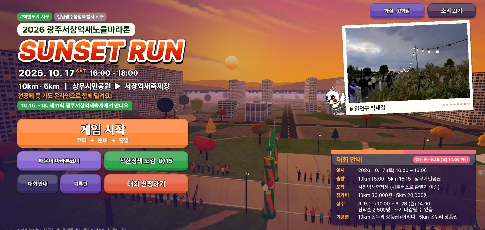
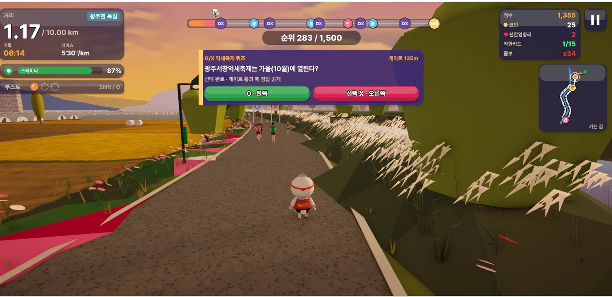
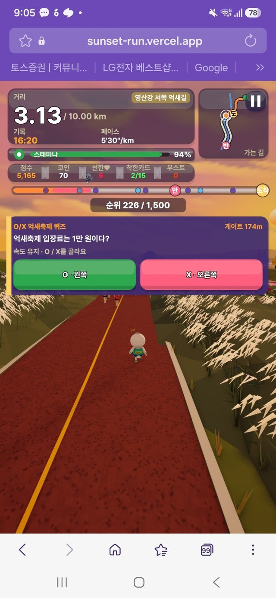

# SUNSET RUN 서구 선셋런

### [▶ 게임 바로 실행하기 · sunset-run.vercel.app](https://sunset-run.vercel.app/)

**지역행사와 정책 정보를 게임으로 만나는 참여형 웹 콘텐츠**

해온이와 함께 영산강 억새노을길을 달리며 정책카드와 O/X 퀴즈를 만납니다. 완주 뒤에는 나의 게임 기록을 확인하고 기념 이미지를 저장·공유할 수 있습니다. 별도 앱 설치 없이 PC·모바일 웹브라우저로 접속합니다.

**광주광역시 서구청 기획실 정의형 제작**



## 주민이 직접 참여하는 행사·정책 안내

선셋런은 **2026 서창억새노을마라톤을 소재로 행사와 정책을 체험하도록 만든 시범 웹게임**입니다. 상무시민공원에서 서창억새축제장으로 이어지는 이야기에 달리기·정책카드·퀴즈·완주 공유를 연결했습니다. 담당자가 알릴 내용을 정하고, AI의 개발 지원으로 시제품을 구현해 실행·수정하는 과정을 통해 공공 홍보에 참여형 콘텐츠를 적용하는 방법을 제안합니다.

## 3단계로 즐깁니다

1. **접속하고 시작하기** — 게임이 로딩되면 닉네임을 입력하고 기록 공개 여부를 선택합니다. 시작 화면은 클릭·터치하거나 키보드 `Enter`·`Space`로 진행합니다.
2. **달리며 알아가기** — 5km·10km 코스와 화면의 조작 안내를 확인합니다. 정책카드를 모으고, O/X 퀴즈에서는 O는 왼쪽, X는 오른쪽 레인을 선택합니다.
3. **완주하고 나누기** — 게임 결과와 모은 카드 수를 확인하고 기념 이미지를 저장·공유합니다. 온라인 공개를 선택하면 실제 게임 참여자의 코스별 최고기록을 확인할 수 있습니다.

## 주요 기능

| 기능 | 사용자가 경험하는 내용 |
| --- | --- |
| 지역행사 러닝게임 | 해온이와 함께 억새·노을길을 달리며 행사 이야기를 만납니다. |
| 정책카드·O/X 퀴즈 | 주행 중 정책과 행사 정보를 접하고 질문에 참여합니다. |
| 5km·10km 코스 | 두 코스의 안내와 코스별 게임 기록을 제공합니다. |
| 온라인 기록판 | 닉네임·최고기록·내 기록을 확인하고 자신의 기록을 삭제할 수 있습니다. |
| 완주 이미지 저장·공유 | 완주 장면과 기록을 담은 이미지를 기기 안에서 만들어 공유합니다. |
| 4단계 화면 품질 | 절약·표준·고화질·최고화질 중 기기에 맞는 설정을 선택합니다. |



**모바일에서도 같은 게임 주소로 접속합니다.**



## AI를 활용한 직접개발

AI는 **기획·코드 작성·반복 수정의 개발 지원**에 활용했습니다. 담당자가 행사 소재와 전달할 내용을 정하고, AI와 함께 첫 버전을 만든 뒤 Unity에서 실행하며 화면과 오류를 바탕으로 수정했습니다. 결과를 웹용으로 빌드해 접속 주소로 공유하는 방식입니다.

현재 게임은 Unity WebGL과 JavaScript로 실행하며, **실시간 AI 추론 기능은 탑재하지 않았습니다.** 개발에 AI를 활용한 범위와 게임이 제공하는 기능을 구분하고, 확인된 개발 과정과 역할은 [AI 개발 기록](docs/ai-development.md)에 정리했습니다.

## 빠르게 실행하기

### 웹에서 바로 체험

[https://sunset-run.vercel.app/](https://sunset-run.vercel.app/)에 접속합니다. WebGL 2와 WebAssembly를 지원하는 최신 브라우저가 필요하며, 첫 접속에는 게임 데이터 다운로드가 발생합니다. 시작 화면에서 클릭·터치한 뒤 소리가 재생되고, 기기 환경에 맞춰 화질을 선택할 수 있습니다.

### 내려받은 파일로 실행

전체 ZIP의 압축을 풀고, Python 3.9 이상이 설치된 Windows PC에서 **`START_WINDOWS.bat`**를 실행합니다. 기본 브라우저가 열리며 게임 파일을 PC 안에서 제공합니다.

명령으로 실행하려면 압축을 푼 폴더에서 한 줄을 입력합니다.

```bash
python tools/serve.py --open
```

브라우저가 자동으로 열리지 않으면 [http://127.0.0.1:8000/](http://127.0.0.1:8000/)으로 접속합니다. 실행 중에는 명령 창을 열어 두고, 종료할 때 `Ctrl+C`를 누릅니다. `index.html` 더블클릭 대신 HTTP 서버로 폴더 전체를 제공해야 합니다. [상세 실행 안내](docs/quickstart.md)

## 검토 자료

- [구동안내서 PDF · 4쪽](docs/quickstart.pdf) — 실행 환경, 주요 화면과 사용 순서
- [상세 실행 안내](docs/quickstart.md) — 로컬 실행, 배포, 문제 해결
- [공공깃랩 업로드 안내](docs/public-gitlab-upload.md) — 파일 구조와 등록 방법
- [AI 개발 기록](docs/ai-development.md) — AI 활용 범위와 개발 과정
- [실제 플레이 촬영용 대본](docs/demo-recording-script.md) — 접속부터 게임 조작·완주까지 보여줄 촬영 계획

**기록 안내:** 게임 속 가상 선수 1,500명의 순위와 실제 웹게임 참여자의 온라인 순위는 다릅니다. 가상 선수 수는 이용자 수가 아니며, 시간·거리는 게임에서 환산한 값입니다. 실제 운동 측정이나 마라톤 공식기록으로 사용하지 않습니다.

<details>
<summary><strong>기술 구성·운영·확산 범위 자세히 보기</strong></summary>

### 구성과 배포

Unity WebGL 실행본에 HTML·CSS·JavaScript 기반 시작 화면·화질·닉네임·기록판·완주 공유 기능을 연결합니다. 기록 API는 Supabase Edge Function을 사용합니다. 별도 npm 설치·빌드 없이 저장된 실행 파일을 정적 호스팅으로 제공합니다.

| 경로 | 역할 |
| --- | --- |
| `index.html` | 시작 화면과 Unity 로딩 |
| `Build/` | 현재 실행하는 11번 Unity WebGL 빌드 |
| `TemplateData/` | 로고·캐릭터 이미지·웹 스타일 |
| `Community/` | 기록 API 연결·닉네임·기록판·완주 공유 |
| `Quality/` | 화면 크기와 화질 설정 |
| `leaderboard.html` | 실제 게임 참여자 기록판 |
| `vercel.json` | 정적 호스팅 응답 설정 |
| `tools/serve.py`, `START_WINDOWS.bat` | 로컬 실행 도구 |
| `docs/` | 구동안내·AI 개발 기록·촬영 대본·화면 자료 |

`index.html`과 관련 폴더를 함께 배포합니다. 현재 `11.loader.js`와 `11.*.unityweb`을 연결하며 Unity 로더가 압축 콘텐츠를 처리합니다. 파일명과 압축 형식을 유지하고, 다른 서버로 옮길 때는 빌드 압축 설정과 HTTP 응답을 맞춥니다.

로컬 실행 명령은 게임 파일을 제공하는 절차입니다. 온라인 기록 기능은 `Community/community-api.mjs`에 지정된 서버의 접속 허용 범위와 설정에 따라 달라집니다.

### 수정과 다른 기관 적용

웹 화면은 해당 파일에서 수정하고, 게임 내부 변경에는 Unity 원본과 새 빌드가 필요합니다. **현재 저장소에는 Unity 프로젝트 원본과 기록 서버·DB 구성 원본이 포함되어 있지 않습니다.** 게임 재빌드나 독립 운영에는 원본과 운영 설정을 별도로 준비해야 합니다.

다른 행사에 적용하려면 해당 지역의 공식 행사·정책 자료로 웹 안내와 게임 안의 카드·퀴즈를 함께 수정합니다. 현재는 행사명을 바꾸면 모든 콘텐츠가 자동 전환되는 범용 제작 기능을 제공하지 않습니다.

### 운영 범위

닉네임과 게임 기록은 공개 선택에 따라 기록 서버로 전달됩니다. 브라우저에 저장한 참여자 ID로 구분하므로 다른 기기나 사이트 데이터 삭제 후에는 별도 참여자가 될 수 있습니다. 완주 이미지는 기기 안에서 생성하며 서버에 자동 업로드하지 않습니다. 기록 보관 안내와 삭제 기능은 기록판에서 확인합니다.

기록판의 `?demo=1` 화면은 예시 데이터입니다. 이를 운영 실적으로 집계하지 않으며, 게임 기록을 경품·시상에 활용하려면 운영자의 별도 검토가 필요합니다. 기기·브라우저·기관망에 따라 로딩과 조작 성능이 달라질 수 있고, 스크린리더 이용과 모바일 확대 접근성은 보완 과제입니다.

행사 표기는 2026년 10월 17일 시범 콘텐츠 기준입니다. 이후 활용할 때는 일정과 정책 정보를 갱신합니다. 로고·캐릭터·음원·에셋의 재사용은 각 구성요소의 이용권을 따릅니다.

### 성과와 제작 배경

정책 인지도 향상, 참여 증가, 예산·시간 절감은 아직 실측하지 않았습니다. 이 자료는 현재 기능과 개발 방식을 설명하며, 활용 효과는 실제 사용 결과로 검증할 과제입니다.

기존 제작가이드에는 서구 펀온워크 에이블(AIBLE)팀의 지역행사 웹게임 제작 활동이 기록되어 있으며, 선셋런은 그 제작 경험을 바탕으로 개선해 온 프로젝트입니다.

</details>

---

**문서 작성일:** 2026년 11월 1일  
**검토한 게임 실행본 기준:** `4192bf908b655cda6918f28422c8c2c0f954ffa7`  
**화면 자료:** 2026년 9월 28일 제작가이드에 수록된 실제 게임 캡처입니다. 현재 배포본과 세부 모습이 다를 수 있으며, 이번 문서 작성에서는 전체 코스 완주·기기별 동작·운영 서버 응답을 다시 검증하지 않았습니다.

[게임 접속](https://sunset-run.vercel.app/) · [개발 저장소](https://github.com/kebong-3/seochang-sunset-run)
